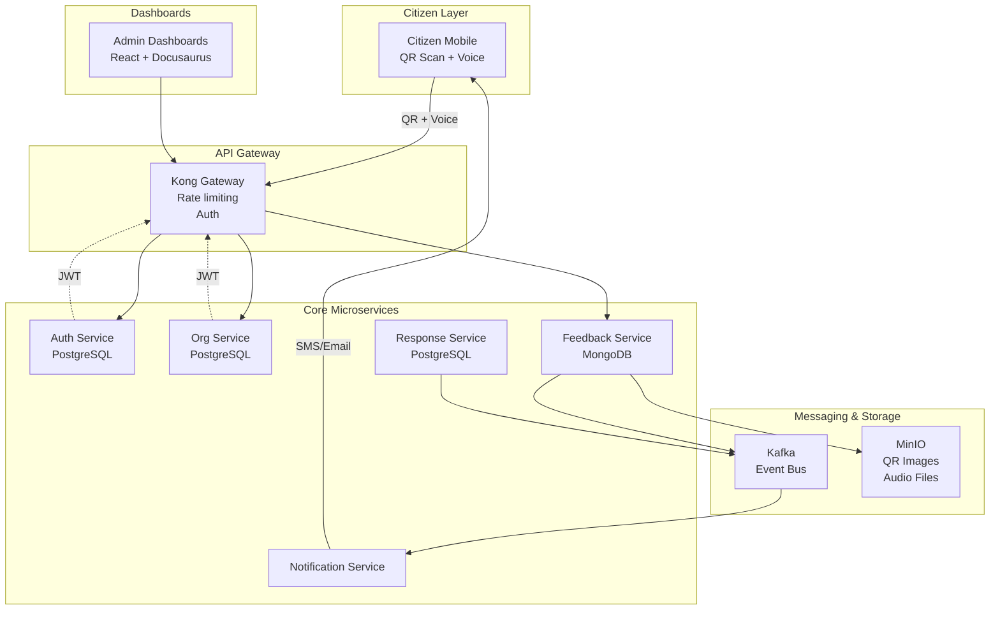
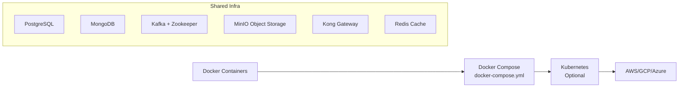

# BoloIndia Microservices Architecture

BoloIndia uses a cloud-native, microservices architecture designed for high availability, multi-tenancy, and horizontal scaling. Each service has clear boundaries and communicates via API Gateway (Kong) and event streaming (Kafka).

## System Architecture Overview

## Service Boundaries & Data Flow

| Service | Purpose | Database | Events Published |
|---------|---------|----------|------------------|
| **Auth Service** | JWT tokens, user roles, multi-tenant auth | PostgreSQL | `user.login`, `org.registered` |
| **Org Service** | Organizations, services, locations, QR management | PostgreSQL | `qr.created`, `service.updated`|
| **Feedback Service** | Receive, validate, store citizen feedback | MongoDB | `feedback.received`, `feedback.categorized` |
| **Response Service** | Admin responses, workflows, status updates | PostgreSQL | `response.created`, `feedback.resolved` |
| **Notification Service** | SMS/Email delivery, citizen updates | None (Kafka consumer) | None |

## Key Architecture Decisions

- **Multi-tenancy**: Tenant ID in every request; database schemas partitioned by organization
- **Event-driven**: Kafka decouples services; feedback → categorization → response → notification
- **Voice storage**: Audio files in MinIO; transcribed text in MongoDB for search/analytics
- **Gateway-first**: Kong handles auth, rate limiting, circuit breaking for all services
- **Dashboards**: React SPA served via Docusaurus; role-based views auto-filter by tenant

## Deployment Stack

This architecture supports **10K+ daily feedbacks per organization** with 99.9% uptime through service isolation and horizontal scaling.

