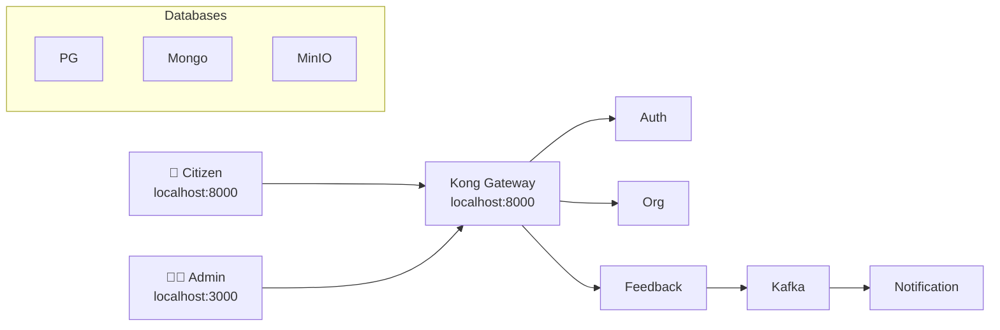

# Run BoloIndia in 5 Minutes (Docker)

BoloIndia provides **three Docker Compose files** for complete local development. All services use the same network `boloindia-net` and default credentials.

## Prerequisites

```
# Clone the repo (or your project directory)
git clone <your-repo>
cd boloindia

# Ensure Docker & Docker Compose are running
docker --version
docker compose version
```

## Step 1: Start Infrastructure (2 minutes)

**📁 Files needed:**
- [`infra/docker-compose.infra.yml`](../../infra/docker-compose.infra.yml) - Main infrastructure
- [`infra/init/001-init-schemas.sql`](../../infra/init/001-init-schemas.sql) - PostgreSQL schemas
- [`infra/mongo-init/001-init-collections.js`](../../infra/mongo-init/001-init-collections.js) - MongoDB collections
- [`infra/monitoring/prometheus.yml`](../../infra/monitoring/prometheus.yml) - Prometheus config

Run from project root:

```
docker compose -f docker-compose.infra.yml up -d
```

**Services started** (all on `boloindia-net`):
- PostgreSQL: `localhost:3606` (user: `boloindia`, pass: `boloindiapass`, db: `boloindia_dev`)
- MongoDB: `localhost:3607` (user: `boloindia`, pass: `boloindiapass`)
- MinIO: `localhost:9000` / `localhost:9001` (user: `boloindia`, pass: `boloindiapass123`)
- Kafka: `localhost:9092` (KRaft mode, no Zookeeper)
- Kong Gateway: `localhost:8000` (proxy) / `8001` (admin)
- Monitoring: Grafana (`3000`), Prometheus (`9090`), Kafka UI (`8090`), Mongo Express (`8081`)

## Step 2: Start API Gateway (Kong)

**📁 Files needed:**
- [`infra/docker-compose.gateway.yml`](../../infra/docker-compose.gateway.yml) - Kong
- [`kong/create-kong-services.bat`](../../kong/create-kong-services.bat) - Auto-register services
- [`kong/create-kong-routes.bat`](../../kong/create-kong-routes.bat) - Auto-create routes
- [`kong/kongo-setup.sh`](../../kong/kongo-setup.sh) - Linux setup script

**Start Kong:**

```
docker compose -f docker-compose.gateway.yml up -d --build
```
**Access Kong Dashboard:**  
<a href="/kong/kongo-dashboard.html" download>Download Kong Dashboard HTML</a> and open locally in your browser.

## Step 3: Setup Kafka Topics

**📁 Scripts:**
- Windows: [`kafka/setup-kafka.bat`](../../kafka/setup-kafka.bat)
- Linux/Mac: [`kafka/setup-kafka.sh`](../../kafka/setup-kafka.sh)

Run your `setup-kafka.bat` (or equivalent):
```
# Windows
setup-kafka.bat

# Linux/Mac (coming next)
./setup-kafka.sh
```

## Step 4: Start Microservices (2 minutes)

```
docker compose -f docker-compose.services.yml up -d --build
```

**7 Microservices** (all expose `/health` endpoints):
| Service | Port | Tech | Database |
|---------|------|------|----------|
| Auth | 6001 | Jakarta EE | PostgreSQL (auth_service schema) |
| Org | 6002 | Jakarta EE | PostgreSQL (org_service) |
| QR | 6003 | Jakarta EE | PostgreSQL (qr_service) |
| Service | 6004 | Jakarta EE | PostgreSQL (service_service) |
| Feedback | 6005 | Node.js | MongoDB |
| Response | 6006 | Node.js | PostgreSQL |
| Notification | 6007 | Node.js | Kafka consumer |


## Step 5: Verify Everything Works

```
# Check all services healthy
docker ps  # All should be "healthy" or "Up"

# Test gateway
curl http://localhost:8000/health

# Access UIs:
# Grafana: http://localhost:3000 (admin/admin)
# MinIO: http://localhost:9001 (boloindia/boloindiapass123)
# Kafka UI: http://localhost:8090
```

## Complete Command Sequence

```
# One-liner (copy-paste ready)
docker compose -f docker-compose.infra.yml up -d && \
docker compose -f docker-compose.gateway.yml up -d && \
docker compose -f docker-compose.services.yml up -d --build && \
./setup-kafka.bat && \
echo "✅ BoloIndia ready! Check http://localhost:3000 (Grafana)"
```

## Network Architecture

