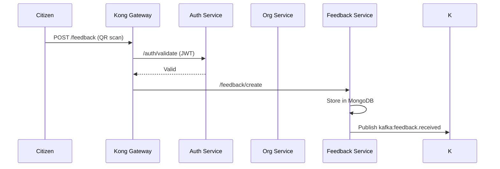

# Configure Services & Create First Organization

After infrastructure is running, configure services and create your first test organization.

## Step 1: Initialize Database Schemas

**📁 SQL Init File:** [`infra/init/001-init-schemas.sql`](../../infra/init/001-init-schemas.sql)

Each Jakarta EE service uses a **dedicated PostgreSQL schema**:

## Step 2: Configure Kong Routes

Access Kong Admin API (`localhost:8001`) and add routes:

```
# Auth Service
curl -X POST http://localhost:8001/services \
-d "name=auth-service" \
-d "url=http://auth-service:8080"

curl -X POST http://localhost:8001/services/auth-service/routes \
-d "paths[]=/auth" \
-d "strip_path=true"

# Repeat for other services...
# org-service: /org → http://org-service:8080
# qr-service: /qr → http://qr-service:8080
# service-service: /service → http://service-service:8080
# feedback-service: /feedback → http://feedback-service:6005
```

## Step 3: Platform Admin User

```
Just check out PostgreSQL db and update the password using bcrypt password for admin@boloindia.in user
```

## Step 4: Apply for organization

```
Go to http://localhost:5173/register/organization
```

## Step 5: Verify Setup

| Endpoint | Status | Expected |
|----------|--------|----------|
| `http://localhost:8000/health` | ✅ 200 | Kong healthy |
| `http://localhost:6001/health` | ✅ 200 | Auth service |
| `http://localhost:6005/health` | ✅ 200 | Feedback service |
| Grafana: `localhost:3000` | ✅ Login | Dashboards ready |

## Service Environment Summary

| Service | Port | Schema | Kafka Topics |
|---------|------|--------|--------------|
| Auth | 6001 | `auth_service` | `user.login` |
| Org | 6002 | `org_service` | `org.registered` |
| QR | 6003 | `qr_service` | `qr.created` |
| Feedback | 6005 | MongoDB | `feedback.received` |
| Response | 6006 | `response_service` | `response.created` |

