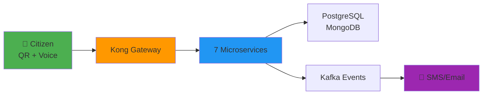
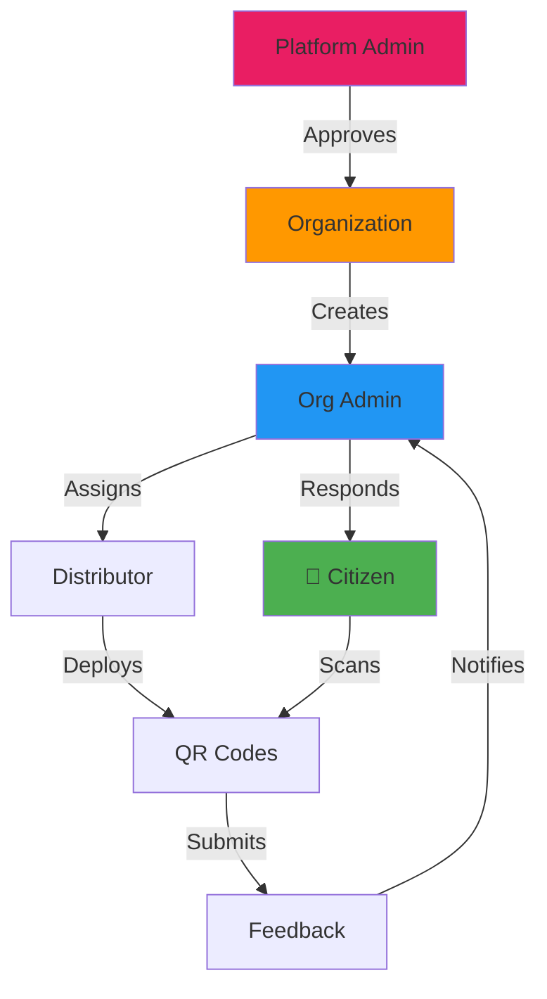

# BoloIndia: Democratizing Citizen Feedback at Scale

**QR-powered, voice-first, multi-tenant feedback platform built for India's diverse population.**

BoloIndia transforms how government organizations, NGOs, and public service providers collect, manage, and act on citizen feedback—eliminating literacy barriers and ensuring every voice is heard.

---

## 🎯 Why BoloIndia?

India's public feedback systems are fragmented, inaccessible, and often invisible to decision-makers. BoloIndia solves four critical problems:

| Problem | BoloIndia Solution |
|---------|-------------------|
| **Literacy Barrier** | 🎤 Voice-first input in 12+ Indian languages—no typing required |
| **Scattered Feedback** | 📍 QR codes auto-link feedback to exact location, service, and organization |
| **No Accountability** | 📊 Role-based dashboards with automated workflows and citizen SMS updates |
| **Poor Scalability** | ☁️ Microservices architecture handles 10K+ feedbacks/day per organization |

---

## ✨ Key Features

### 🔊 Voice-First Input
- **30-second audio feedback** stored in MinIO
- **Automatic transcription** in Hindi, English, Tamil, Telugu, and more
- Zero typing—perfect for low-literacy citizens

### 📲 QR Code Intelligence
- Each QR encodes: `Organization + Service + Location`
- Print and deploy at: hospitals, ward offices, bus stops, schools
- Real-time analytics: scan rates, peak hours, popular locations

### 🏢 Multi-Tenant Architecture
- **100% data isolation** between organizations
- Each org gets: dedicated dashboard, custom workflows, role-based access
- Support for: municipalities, hospitals, NGOs, transport agencies

### 🔄 Event-Driven Workflows
- **Kafka-powered automation**: Feedback → Categorization → Assignment → Response → SMS
- Real-time notifications via SMS/email to citizens
- Escalation rules for high-priority issues

### 📊 Advanced Analytics
- Service-wise feedback trends
- Resolution time tracking
- Heatmaps for feedback hotspots
- Export reports: CSV, Excel, PDF

### 🔐 Enterprise Security
- JWT-based authentication with role-based access control (RBAC)
- Platform Admin → Org Admin → Distributor → Citizen hierarchy
- API Gateway (Kong) with rate limiting and circuit breakers

---

## 🏗️ Technology Stack



| Component | Technology                | Purpose                        |
|-----------|---------------------------|--------------------------------|
| **Backend** | Jakarta EE + Node.js      | 7 independent microservices    |
| **Databases** | PostgreSQL 15 + MongoDB 7 | Relational + document storage  |
| **Messaging** | Apache Kafka 3.7 (KRaft)  | Event streaming                |
| **Storage** | MinIO                     | Audio files, QR images         |
| **Gateway** | Kong 3.5                  | API proxy, auth, rate limiting |
| **Monitoring** | Grafana + Prometheus      | Real-time metrics              |
| **Frontend** | React.js + Material-UI    | Admin/Citizen portals          |
| **Mobile** | Jetpack Compose, Kotlin   | Distributor mobile app         |

---

## 🚀 Quick Start (5 Minutes)

```
# Clone all repositories
git clone https://github.com/PatelShakil/FMS_AUTH_SERVICE.git
git clone https://github.com/PatelShakil/FMS_FEEDBACK_SERVICE.git
# ... (see GitHub Projects page for all 10 repos)

# Start infrastructure
docker compose -f infra/docker-compose.infra.yml up -d

# Start Kong Gateway
docker compose -f kong/docker-compose.yml up -d
kong/create-kong-services.bat

# Start microservices
docker compose -f infra/docker-compose.services.yml up -d --build

# Access dashboards
# Grafana: http://localhost:3000 (admin/admin)
# MinIO: http://localhost:9001 (boloindia/boloindiapass123)
# Kafka UI: http://localhost:8090
```

**Full guide:** [Installation Quickstart →](installation/quickstart)

---

## 📱 User Roles



| Role | Access              | Responsibilities |
|------|---------------------|------------------|
| **Platform Admin** | Full system         | Approve orgs, monitor health, analytics |
| **Organization** | Org-level dashboard | View aggregate metrics, manage admins |
| **Org Admin** | Service + feedback  | Review, categorize, respond, assign staff |
| **Distributor** | QR Code             | Print, deploy, track QR codes |
| **Citizen** | Web Portal          | Scan QR, speak feedback, track status |

---

## 🎯 Real-World Use Cases

### 🏥 Hospitals
- QR at: reception, wards, pharmacy, emergency
- Feedback on: wait times, staff behavior, cleanliness
- Automated escalation for critical issues

### 🏛️ Municipalities
- QR at: ward offices, public toilets, parks, street lights
- Track: potholes, garbage complaints, water supply issues
- Heatmap for high-complaint zones

### 🚌 Transport Services
- QR inside: buses, metro stations, railway platforms
- Monitor: driver behavior, safety, cleanliness
- Real-time alerts for urgent repairs

### 🏫 Schools & Universities
- QR at: classrooms, labs, libraries, canteens
- Feedback on: teaching quality, facilities, food
- Anonymous option for sensitive issues

---

## 🌟 What Makes BoloIndia Different?

| Generic Form Builders | BoloIndia |
|----------------------|-----------|
| Text-only input | 🎤 Voice + text in 12+ languages |
| No context | 📍 Auto-linked to service/location via QR |
| Single-tenant | 🏢 Multi-tenant with full data isolation |
| Manual follow-up | 🔔 Automated SMS/email notifications |
| No workflows | 📊 Built-in categorization, assignment, escalation |
| Cloud-only | 🐳 Docker-based, deploy anywhere |

---

## 📚 Documentation Sections

Explore detailed guides:

- **[Solution Overview →](solution/overview)** - User roles, end-to-end workflow
- **[Architecture →](architecture/overview)** - Microservices, databases, Kafka
- **[Installation →](installation/quickstart)** - Docker setup, Kong config
- **[Usage Guide →](usage/qr-citizen)** - QR generation, citizen testing
- **[GitHub Projects →](resources/github-projects)** - Clone all 10 repositories

---

## 🤝 Contributing

BoloIndia is open source! All repositories are available on GitHub:

- 7 Backend microservices (Jakarta EE + Node.js)
- 2 Frontend apps (React.js)
- 1 Mobile app (Jetpack Compose, Kotlin)

**[View All Repositories →](resources/github-projects)**

---

## 📞 Support & Community

- **GitHub Issues**: Report bugs, request features
- **Email**: patelshakil@techsavvysolution.in
- **Documentation**: **[View Docs →](https://docs.boloindia.techsavvysolution.in)** 
- **Demo**: [Live demo link]

**Built with ❤️ for India's digital governance revolution.**

---

## 👨‍💻 Developed By

<div style={{display: 'flex', alignItems: 'top', gap: '20px', marginBottom: '20px'}}>
  
  <div>
    <h3 style={{marginBottom: '5px'}}>MuhammadShakil Patel</h3>
    <p style={{marginBottom: '5px'}}>Full Stack Developer & Software Architect</p>
    <p style={{marginBottom: '10px'}}>Specializing in Microservices, Cloud Architecture, and Enterprise Java</p>
    <div>
      <a href="https://github.com/PatelShakil" target="_blank">🔗 GitHub</a> • 
      <a href="https://patelshakil.techsavvysolution.in" target="_blank"> 🌐 Portfolio</a> • 
      <a href="https://linkedin.com/in/patelshakil" target="_blank"> 💼 LinkedIn</a>
    </div>
  </div>
</div>

---

## 🎓 Guided By

**Dr. Kamlendu Pandey**  
Associate Professor, Department of Information & Communication Technology  
J P Dawer Institute of IT & ICT, VNSGU

Expert guidance in Software Engineering, Microservices Architecture, and System Design.

---

## 🏛️ Academic Institution

**J. P. DAWER INSTITUTE OF INFORMATION SCIENCE & TECHNOLOGY DEPARTMENT OF I.C.T.**  
Veer Narmad South Gujarat University (VNSGU)  
Surat, Gujarat, India

*Empowering innovation through cutting-edge IT education and research.*

---

**Built with ❤️ for India's digital governance revolution.**

---

## 📄 License

This project is open source and available under the [MIT License](https://opensource.org/licenses/MIT).
