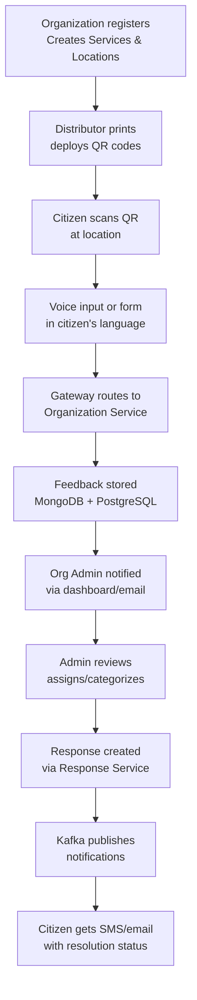

# BoloIndia Solution – How It Works

BoloIndia transforms fragmented feedback into a structured, actionable workflow using QR codes, voice input, and role-based dashboards. The system supports multiple organizations while maintaining strict data isolation between them. [file:31][file:32]

## User Roles at a Glance

| Role | Responsibilities | Access |
|------|------------------|---------|
| **Platform Admin** | Manages organizations, monitors system health, assigns QR distributors | Full platform dashboard |
| **Organization** | Registers, creates services/locations, monitors aggregate metrics | Org-specific dashboard |
| **Org Admin** | Manages QR codes, reviews/responds to feedback, assigns staff | Service-level workflows |
| **Distributor** | Prints and physically deploys QR codes at locations | QR assignment portal |
| **Citizen** | Scans QR, speaks feedback (voice) or types, tracks status | Mobile-first interface |

## End-to-End Feedback Journey

This flow ensures every feedback item is traceable from citizen input → organizational action → verified closure.

## What Makes This Different

Unlike generic form builders, BoloIndia provides:

- **QR-context binding** – Each QR encodes organization + service + location automatically
- **Voice-first input** – 90% of India prefers speaking over typing; supports 12+ Indian languages
- **Multi-tenant isolation** – Each organization gets dedicated data partition + dashboards
- **Workflow automation** – Feedback → categorization → assignment → response → citizen notification
- **Scalable architecture** – Microservices + Kafka + MinIO handles 10K+ feedbacks/day per org
