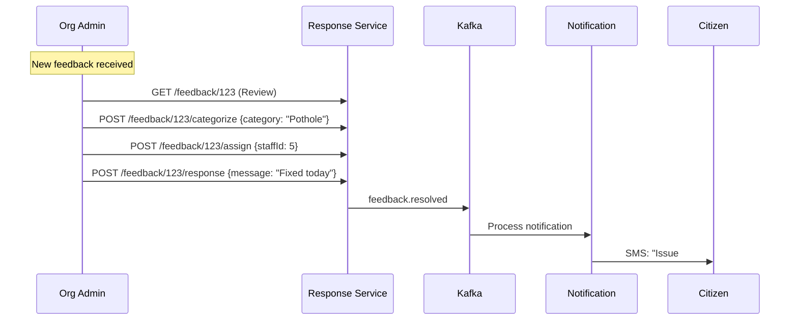
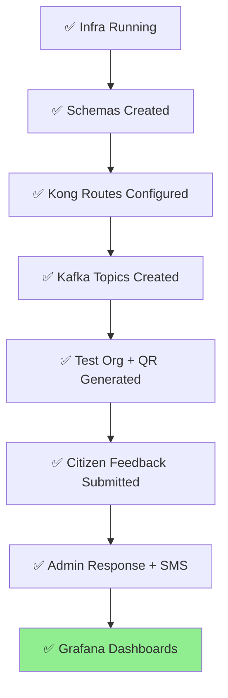

# Org Admin Dashboard & Feedback Workflows

Org Admins access role-based dashboards to review, categorize, respond, and track feedback resolution.

## Step 1: Access Org Admin Dashboard

```bash
# Login as Org Admin
ORG_TOKEN=$(curl -s -X POST http://localhost:8000/auth/login \
  -H "Content-Type: application/json" \
  -d '{"email":"orgadmin@test-muni.com","password":"org123"}' | jq -r .token)

# View organization feedback
curl -H "Authorization: Bearer $ORG_TOKEN" \
  http://localhost:8000/org/1/feedback?status=pending
```

**Dashboard endpoints** (all filtered by organization):


| Endpoint | Purpose | Filters |
| :-- | :-- | :-- |
| `/org/{id}/feedback` | List all feedback | `status=pending`, `serviceId=1` |
| `/org/{id}/feedback/{id}` | View single feedback | Includes audio playback |
| `/org/{id}/stats` | Analytics dashboard | Monthly trends, service-wise |
| `/org/{id}/qr` | QR code management | Generate, assign, track usage |

## Step 2: Complete Feedback Workflow




### Test the workflow:

```bash
# 1. Categorize feedback
curl -X POST http://localhost:8000/feedback/1/categorize \
  -H "Authorization: Bearer $ORG_TOKEN" \
  -H "Content-Type: application/json" \
  -d '{"category": "Pothole", "priority": "HIGH"}'

# 2. Create response
curl -X POST http://localhost:8000/feedback/1/response \
  -H "Authorization: Bearer $ORG_TOKEN" \
  -H "Content-Type: application/json" \
  -d '{
    "response": "Team dispatched. Fixed by 6 PM today.",
    "status": "RESOLVED",
    "staffAssigned": "Road Repair Team"
  }'
```


## Step 3: Monitoring Dashboards

| Tool | URL | Purpose |
| :-- | :-- | :-- |
| **Grafana** | `localhost:3000` | Service metrics, response times |
| **Kafka UI** | `localhost:8090` | Event streams, topic monitoring |
| **Mongo Express** | `localhost:8081` | Raw feedback documents |
| **MinIO** | `localhost:9001` | Audio files, QR images |

## Step 4: Production Checklist



**Full stack verified!** 🎉

## Troubleshooting

| Issue | Solution |
| :-- | :-- |
| Kong 502 | Check service health: `docker ps` |
| Kafka no topics | Run `setup-kafka.bat` |
| Auth 401 | Check JWT keys in `./keys/` |
| Feedback not stored | MongoDB: `localhost:3607` 
