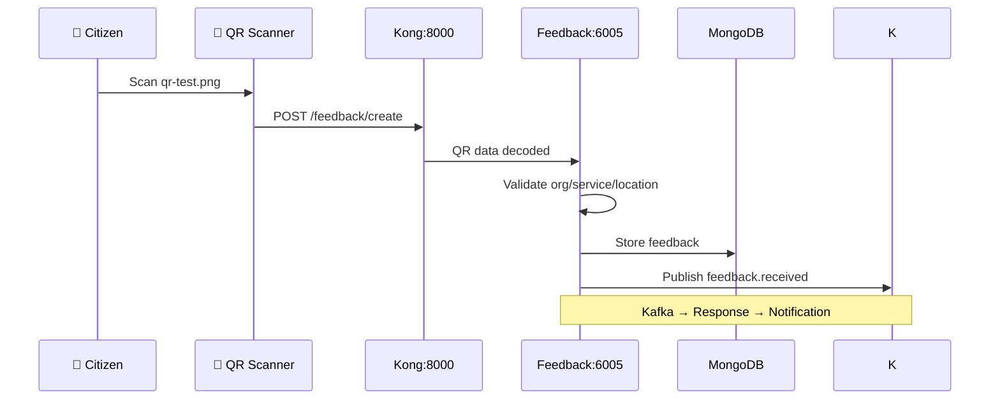
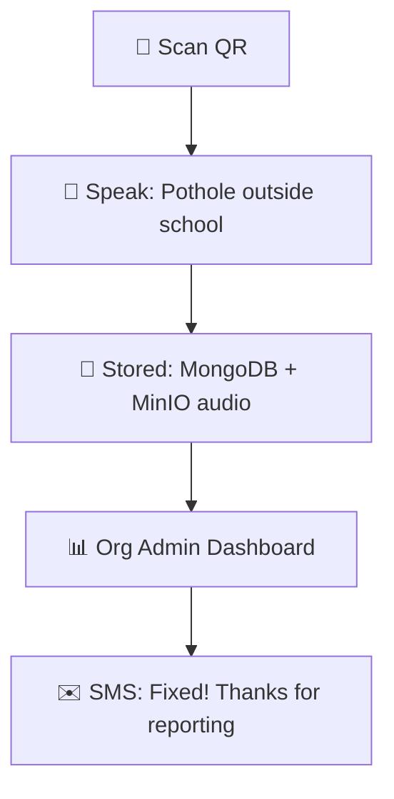

# Generate QR Codes & Test Citizen Flow

Test the complete feedback journey: Org Admin → QR creation → Citizen scan → Feedback submission.

## Step 1: Login as Org Admin

```bash
# Get platform admin token first
TOKEN=$(curl -s -X POST http://localhost:8000/auth/login \
  -H "Content-Type: application/json" \
  -d '{"email":"admin@boloindia.com","password":"admin123"}' | jq -r .token)

# Create Org Admin user for "Test Municipality"
ORG_ADMIN_TOKEN=$(curl -s -X POST http://localhost:8000/auth/register/org-admin \
  -H "Authorization: Bearer $TOKEN" \
  -H "Content-Type: application/json" \
  -d '{
    "email": "orgadmin@test-muni.com",
    "password": "org123",
    "organizationId": 1,
    "name": "Test Org Admin"
  }' | jq -r .token)
```

## Step 2: Create Service & Location

```bash
# Create Service (e.g. "Road Maintenance")
curl -X POST http://localhost:8000/service \
  -H "Authorization: Bearer $ORG_ADMIN_TOKEN" \
  -H "Content-Type: application/json" \
  -d '{
    "name": "Road Maintenance",
    "description": "Potholes, street lights, drainage"
  }'

# Create Location (e.g. "Ward 5 - Main Road")
curl -X POST http://localhost:8000/service/1/locations \
  -H "Authorization: Bearer $ORG_ADMIN_TOKEN" \
  -H "Content-Type: application/json" \
  -d '{
    "name": "Ward 5 - Main Road",
    "latitude": 28.6139,
    "longitude": 77.2090,
    "address": "Main Road, Ward 5, Test Municipality"
  }'
```

## Step 3: Generate QR Code

```bash
# Generate QR for specific service + location
curl -X POST http://localhost:8000/qr/generate \
  -H "Authorization: Bearer $ORG_ADMIN_TOKEN" \
  -H "Content-Type: application/json" \
  -d '{
    "serviceId": 1,
    "locationId": 1,
    "qrType": "FEEDBACK"
  }' \
  --output qr-test.png
```

**Download `qr-test.png`** and print/scan it!

## Step 4: Test Citizen Feedback Flow

### QR encodes: `orgId=1&serviceId=1&locationId=1`



### Test with curl (simulate citizen):

```bash
curl -X POST http://localhost:8000/feedback/create \
  -H "Content-Type: application/json" \
  -d '{
    "qrData": "orgId=1&serviceId=1&locationId=1",
    "voiceAudio": "data:audio/wav;base64,...",
    "text": "Pothole on main road, very dangerous!",
    "language": "hi",
    "citizenPhone": "+919876543210"
  }'
```

## Step 5: Verify End-to-End

| Check | URL/Location | Expected |
|-------|--------------|----------|
| **QR Image** | `qr-test.png` | Valid QR with org/service/location |
| **Feedback stored** | MongoDB (localhost:3607) | New document in `feedbacks` collection |
| **Kafka event** | Kafka UI (localhost:8090) | `feedback.received` topic |
| **Org Admin dashboard** | `localhost:8000/org/1/feedback` | New feedback visible |

## Citizen Mobile Experience

1. **Scan QR** → Auto-opens feedback form
2. **Speak** (30s audio) or **type** in Hindi/English
3. **Submit** → Instant "Thank you" + tracking ID
4. **SMS update** when Org Admin responds

